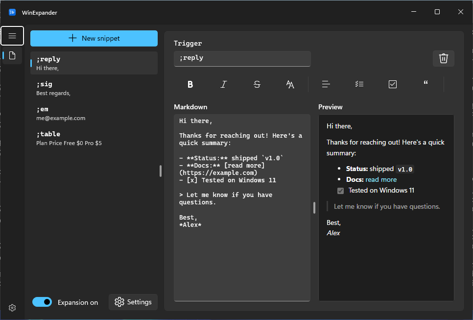
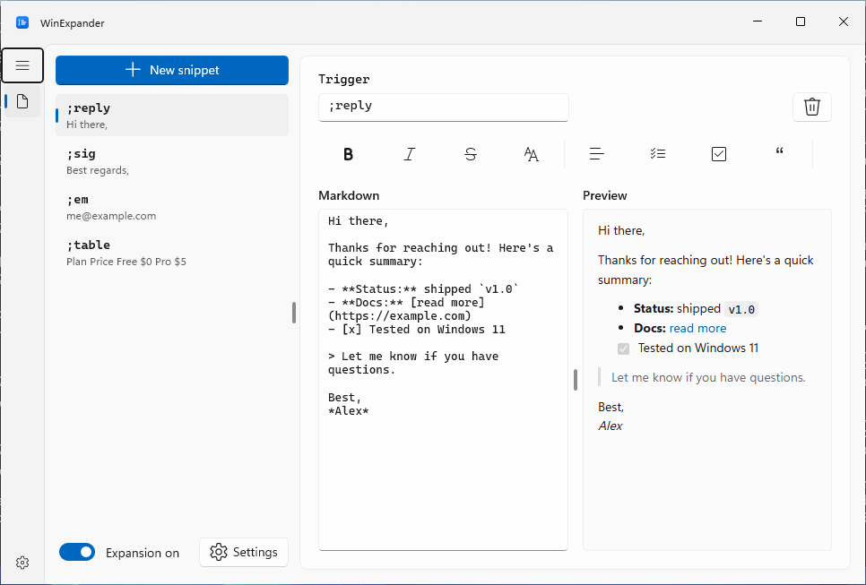
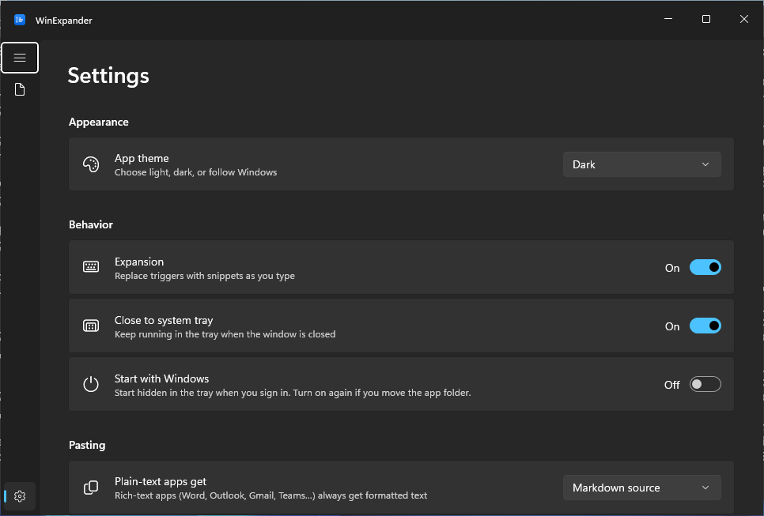

# WinExpander

Minimal, portable text expander for Windows 11. Type a trigger like `;sig` anywhere and it becomes your snippet.



| Light | Settings |
|---|---|
|  |  |

## Download
Get the zip from [Releases](../../releases/latest) (x64 or arm64), unzip, run `WinExpander.exe`. No install.

## Features
- Markdown snippets with live preview
- Rich text in Word, Outlook, Gmail, etc.; Markdown or plain text elsewhere
- Clipboard restored after each expansion
- Light/dark theme, tray icon, start with Windows
- Portable: snippets saved in `snippets.json` next to the exe
- Built with WinUI 3 and the [Windows Community Toolkit](https://github.com/CommunityToolkit/Windows)

## Build
Requires Visual Studio 2022 (or Build Tools) with the .NET desktop workload.

```
powershell -ExecutionPolicy Bypass -File .\build.ps1
```

## Notes
- Won't expand in apps running as admin unless WinExpander is too.
- Nothing is logged or sent anywhere.

## License
[MIT](LICENSE)
